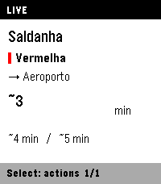
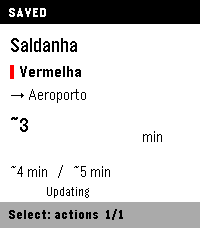

# Metro Lisboa for Pebble Time 2

Lisbon Metro arrival estimates on your wrist. A small native C watch app with a
PebbleKit JavaScript phone companion, connecting directly to [UnderLX](https://underlx.com/).

**Target:** Pebble Time 2 (`emery`), firmware 4.33+, and Android. Other watches and
iOS are not currently supported. Version 0.2 is under hardware validation;
emulator results are not a guarantee of reliability or battery life on every device.




Screenshots use deterministic emulator fixtures, not live train observations.

## Features

- Up to 16 station / line / direction favourites, including interchange selection.
- Next three estimates with local countdowns and strict source expiry.
- Seconds when supplied; minute-only estimates remain approximate (`~3 min`).
- A tiny animated train while connecting, without blocking navigation.
- Two recent routes saved for quick reopen, explicitly labelled **SAVED**.
- Retry, confirmed removal, and UnderLX attribution.

No alerts, vibration, line-status pages, GPS, watch-side JavaScript runtime,
background worker, custom Android app or custom backend. The paired phone needs
the Pebble mobile app and internet access. See [privacy](PRIVACY.md).

## Controls

| Screen | Buttons |
| --- | --- |
| Arrivals | Up/Down: switch favourites · Select: actions · Back: favourites |
| First use | Select: station → line if needed → direction → save |
| Lists | Up/Down: choose (hold to repeat) · Select: open · Back: return |
| Actions | Retry live data or remove the favourite with confirmation |
| Favourites | Open a route, add another, retry, or view About / data |

Back at the favourites root or empty screen exits the app.

## Saved arrivals

All favourites persist. Arrival snapshots and short labels persist for **two
recently viewed routes**; other snapshots are RAM-only while the app runs.
Reopening shows SAVED estimates only while their original validity remains.
Time spent closed is subtracted; saving never renews expiry.

Fresh source data becomes LIVE. Empty updates, connection loss, manual Retry and
clock jumps invalidate estimates. Expired numbers disappear; route labels can
remain. **Due / Estimated now** is an estimate, not proof a train is at the platform.

Writes are batched about every 15 seconds and flushed on normal exit, focus loss
or route changes. The countdown does not write storage every second. The loading
train stops after at most 15 seconds per attempt or on explicit failure.

**Upgrading from 0.1 / Alloy:** favourites do not migrate automatically to native
storage. Re-add them after upgrading. The old store is left untouched; uninstalling
or erasing app data is not a migration step.

## Build

Install the [Pebble tools](https://developer.repebble.com/sdk/), SDK **4.33.1**,
and Node **24.21.0**. The pinned tool versions and Linux CI setup are in
[the workflow](.github/workflows/e2e.yml).

```sh
pebble sdk install 4.33.1
npm ci
npm run check
```

The SDK names the package after the checkout directory:
`build/<checkout-directory-name>.pbw`. For a clone named `pebble-metro`, this is
`build/pebble-metro.pbw`.

- `npm run build` — native watch app and bundled phone JavaScript.
- `npm run check` — phone entry syntax and production build.
- `npm run typecheck` — TypeScript emulator harness checks.
- `npm run e2e` — typecheck, build and real-emulator tests.
- `npm run assets:screenshots` — explicitly recapture unmasked store screenshots.

Do not add `"type": "module"` to the root package: the SDK generates a CommonJS
webpack configuration. A small build-time adapter handles the phone's ESM sources.
Clean with `pebble clean --sdk 4.33.1` after changing SDK or project type.

## Test and install

```sh
npx playwright install chromium
npm run e2e
```

The tests run the actual package and phone bundle with real buttons, AppMessage
receipts and disposable Emery QEMU storage. REST/MQTT fixtures replace only the
external data sources. Tests never connect to a physical watch. They cover reopen,
expiry, phone restart, source replacement and 16-favourite/160-switch memory stress.
See [E2E documentation](docs/e2e.md) and [contributing](CONTRIBUTING.md).

To install on your own watch, enable Developer Connection in the Android Pebble app:

```sh
pebble ping --cloudpebble
pebble install --cloudpebble "build/$(basename "$PWD").pbw"
```

Use `--phone PHONE_ADDRESS` instead for a reachable LAN phone. Installation replaces
the app with the same UUID; read the migration note above before upgrading.

## Documentation and licensing

- [Architecture and protocol](docs/architecture.md)
- [UI and cache flow](docs/design.md)
- [Appstore publishing and listing draft](docs/appstore.md)
- [Artwork and screenshots](assets/README.md)
- [Release checklist](docs/publishing-todo.md)
- [Privacy](PRIVACY.md)
- [Third-party notices](THIRD_PARTY_NOTICES.md) and [licence texts](LICENSES/)

Original project code is licensed under [0BSD](LICENSE): use, modify, redistribute
or sell it without an attribution requirement. It is provided without warranty.
Third-party components and UnderLX data retain their own terms; see the notices.

Independent application, not affiliated with or endorsed by Metro de Lisboa.
Data: **UnderLX**, under **ODbL 1.0** unless otherwise indicated by the provider.
