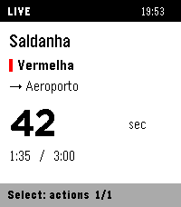
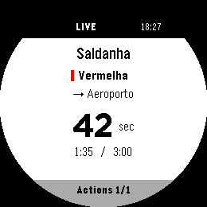

# Metro Lisboa for Pebble

Lisbon Metro arrival estimates on your wrist. Native C on the watch, with a
TypeScript/PebbleKit JS phone companion connecting directly to
[UnderLX](https://underlx.com/).

**Get the app:** [Pebble Appstore](https://apps.repebble.com/dce54d3eb02943f1935e1529)
· [Rebble Appstore](https://apps.rebble.io/en_US/application/6af0e5dfb99ed90009374190).

**Source:** [GitHub](https://github.com/rafaelborges29/pebble-metro).

**Supported:** Pebble Time 2 (`emery`, 200×228), Pebble Round 2 (`gabbro`,
260×260), firmware 4.33+, and Android. Original Time Round (`chalk`), other watches
and iOS are not supported. Round 2 has emulator coverage; physical-watch acceptance
remains pending.




Screenshots use artificial emulator estimates, not live observations. Contains
information from [UnderLX](https://underlx.com/), made available under
[ODbL 1.0](https://opendatacommons.org/licenses/odbl/1-0/).
See [UnderLX data notices](THIRD_PARTY_NOTICES.md#underlx-data).

## Features

- Up to 16 station / line / direction favourites, including interchanges.
- Next three estimates; seconds only when supplied, approximate minutes otherwise.
- Two recent routes saved for reopening, clearly marked **SAVED**. Saving never
  renews source expiry; expired or invalidated numbers disappear.
- English and Portuguese (`pt_PT`), selected by the watch's system locale.
- Button navigation, optional touch prototype, and a bundled phone favourites editor.
- A small animated train while connecting; navigation stays available.

The paired phone needs the Pebble Android app and internet for live updates.
No GPS, app-specific account, analytics, advertising, alerts, background worker,
custom backend or separate Android app. See [privacy](PRIVACY.md).

## Use

| Screen | Buttons |
| --- | --- |
| Arrivals | Up/Down: switch favourites · Select: actions · Back: favourites |
| First use / Add favourite | Select: line → station → direction → save |
| Lists | Up/Down: choose (hold to repeat) · Select: open · Back: return |
| Actions | Retry live data or remove with confirmation |
| Favourites | Open a route, add another, or retry |

Back at the favourites root or empty screen exits. **Due / Estimated now** is an
estimate, not proof that a train is at the platform. All favourites persist; only
two recent arrival snapshots persist, and only for their original validity.

**Phone editor:** enable **Settings → Plugins → Plugins / permissions preview**
in a compatible Pebble Android app, then open Metro Lisboa's **Settings** with the
watch app running. Add and confirmed Remove save immediately without closing the
page. Approve Internet access to `api.underlx.com` and `perturbacoes.pt` in Pebble's
native permission UI. No separate website or plugin is needed.
See [phone setup, permissions and recovery](docs/phone-configuration.md).

**Touch prototype:** firmware 4.33.2+ and system touch enabled are required. Tap
visible rows, swipe up/down to navigate or right for Back; tap arrival content for
Actions. Removal needs a separate confirmation tap. Headers, footers and round
corners are not targets. Buttons remain available. Touch usability is unverified;
there are no touch tests. See [UI flow](docs/architecture.md#watch-ui-and-navigation).

**Language:** `pt_PT` selects Portuguese; all other locales fall back to English.
The phone editor follows the watch language when opened. Changing language does
not change favourites or cached estimates. See [translations](CONTRIBUTING.md#translations).

## Development

Use Linux x86-64, Node **24.22.2**, Pebble Tool **5.0.39**, `libpebble2` **0.0.31**
and SDK **4.33.1**. See [contributor setup](CONTRIBUTING.md#setup-and-checks)
for installation and system dependencies.

```sh
npm ci
npm run check
npx playwright install --only-shell chromium
npm run e2e
```

Builds/checks compile both watch targets. E2E uses disposable emulators, not a
physical watch. The default build has the **production UUID**: installing it
replaces live. Build alone does not authorize installation.

### Install development on your watch

Enable Developer Connection in Pebble Android. The default owner connection is:

```sh
npm run install:dev -- --cloudpebble
# Only for an explicitly chosen LAN connection on trusted Wi-Fi:
npm run install:dev -- --phone 192.168.1.42
```

The guarded installer builds and verifies the dev identity in the PBW and both
native binaries before sending that exact package. Never bypass it with bare
`pebble install`. **Metro Lisboa Dev** has its own permanent UUID, favourites,
phone storage and Internet grants; it coexists with store-installed **Metro
Lisboa**. Rerun the command to update dev **without uninstalling**. Never uninstall
live, wipe the watch or clear phone data for this workflow.

See [development identities and hardware acceptance](CONTRIBUTING.md#development-builds).

## Documentation

- [Contributing, setup and translations](CONTRIBUTING.md)
- [Architecture, UI, protocol and persistence](docs/architecture.md)
- [Emulator tests and diagnosis](docs/e2e.md)
- [Phone configuration](docs/phone-configuration.md)
- [Store listing, privacy copy and Rebble requirements](docs/appstore.md)
- [Releases and recovery](docs/releases.md) · [Artwork and screenshots](assets/README.md)
- [Security reporting](SECURITY.md)

## Licensing

Original code and artwork use [0BSD](LICENSE), without an attribution requirement
and without warranty. Third-party software and UnderLX-derived data retain their
own terms: [third-party notices](THIRD_PARTY_NOTICES.md) and [licence texts](LICENSES/).

A distributed PBW contains extractable phone JavaScript and a source map.
Do not put credentials or confidential data in the client bundle.

Independent application, not affiliated with or endorsed by UnderLX or Metro de
Lisboa. Data adaptations remain ODbL 1.0 unless the provider indicates otherwise.
