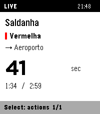
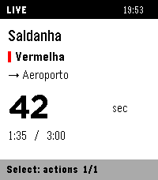
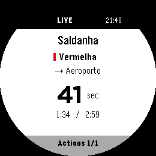
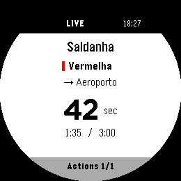

# Architecture

Native C on Time 2 (`emery`) / Round 2 (`gabbro`); strict TypeScript compiled to
PebbleKit JS on Android. Supported versions/setup are in [Contributing](../CONTRIBUTING.md).

```text
UnderLX HTTPS catalogue / MQTT arrivals
    ↕
Phone companion: validation, metadata cache, bounded transport, local settings page
    ↕ AppMessage chunks + application receipts
Watch: fixed-size model, one window/drawing layer, checked persistence
```

No custom backend, GPS, alerts, vibration, background worker or watch-side JS.
Original software is 0BSD; [UnderLX-derived data remains ODbL](../THIRD_PARTY_NOTICES.md#underlx-data).

| Implementation | Responsibility |
| --- | --- |
| [`src/common/metro.ts`](../src/common/metro.ts), [`types.ts`](../src/common/types.ts) | Source validation and shared contracts |
| [`src/pkjs/companion.ts`](../src/pkjs/companion.ts), [`transport.ts`](../src/pkjs/transport.ts) | Source/cache coordination and chunk delivery |
| [`src/pkjs/settings.ts`](../src/pkjs/settings.ts), [`settings-page.ts`](../src/pkjs/settings-page.ts) | Live phone editor and self-contained page |
| [`src/c/main.c`](../src/c/main.c), [`json.c`](../src/c/json.c) | Native model, UI, protocol, cache and bounded JSON parsing |
| [`src/c/favorites.c`](../src/c/favorites.c) | Transactional favourite storage and migration |

## Watch UI and navigation

```text
Launch → last viewed arrivals
  Up/Down → previous/next favourite; Select → Retry / confirmed Remove
  Back → favourites list → open route / Add favourite / Retry
First use / Add favourite → line → station → direction → save
Back at favourites root or empty screen → exit
```

Lists support hold-to-repeat. Stations are alphabetical within the selected line;
interchanges retain that line and termini exclude the origin. Back restores picker
position; cancelling saves no draft. Catalogue replacement resets open drafts.
Removal preserves surviving slots, arrival state and original expiry.

Arrivals show line colour, watch-local clock, station/destination and three estimates.
Textual line names remain in the picker. Both screen shapes keep four menu rows;
Round 2 centers measured text/ETA groups and insets rows/header/footer into its
safe area. Wide values fall back from LECO 60 to smaller system fonts; ranges,
Due and missing data use Gothic. There are no custom fonts or invented precision.

The loader uses four frames on the existing one-second tick, pauses without focus
and stops after 15 seconds per attempt/target or explicit failure. Navigation stays
available. Static menus redraw on changes/minute ticks, not every second.

Reviewed numeric-layout captures use artificial estimates, not live observations:

| Target | Before | Current |
| --- | --- | --- |
| Time 2 |  |  |
| Round 2 |  |  |

Contains information from [UnderLX](https://underlx.com/), made available under
[ODbL 1.0](https://opendatacommons.org/licenses/odbl/1-0/).

### Touch input

One SDK tap recognizer and one swipe recognizer are owned by the window on
`PBL_TOUCH` targets with firmware 4.33.2+. Older firmware/allocation failure keeps
buttons; the version guard avoids the older recognizer-enabling crash. SDK button
emulation is disabled to avoid duplicate actions; every physical binding remains.

Tap visible rows, swipe up/down for next/previous or right for Back. Arrival-content
taps open Actions; first-use content adds/retries, and notice content returns.
Headers, footers, blank rows and round corners are excluded. Navigation, catalogue
changes, focus/visibility loss or a changed contact target cancel the latched touch;
removal needs a fresh confirmation contact. Recognizers reuse button actions without
per-gesture allocation. Touch usability remains unverified; do not add/run touch tests.

## Phone compilation and types

SDK builds compile strict ES2015/CommonJS into `build/phone/` before webpack.
Type errors stop packaging. Do not add root `"type": "module"` or edit generated
JavaScript. [`bootstrap.cjs`](../src/pkjs/bootstrap.cjs) loads compiled code and
bundled notices; no TypeScript runtime is shipped. External JSON stays `unknown`
until runtime validation on both phone/native boundaries. The serialized settings
client may use type-only imports, not runtime captures/imports or compiler helpers.

## Native memory design

Capacities in `main.c` are fixed; navigation/parsing do not allocate model storage.

| Bound | Capacity |
| --- | --- |
| Catalogue | 80 stations, eight lines |
| IDs / labels | 48-byte ASCII IDs; full names validated at 240/120 UTF-8 bytes, display labels truncated safely to 80/40 |
| Favourites / arrivals | 16 routes, three predictions each; one fixed whole-list staging array |
| Durable arrival cache | Two recent routes; other valid snapshots are RAM-only |
| Reassembly / decoded chunk | 5,000 / 2,000 bytes |
| JSON tokens / nesting | 1,024 / 16 |
| AppMessage inbox / outbox | 4,096 / 1,024 bytes |

The token buffer has one checked startup allocation, freed on shutdown, to keep the
SDK virtual image below 64 KiB. JSON parsing is nonrecursive, validates UTF-8,
escapes/surrogates/numbers and rejects NUL, duplicate matching keys and capacity
violations. One window/layer draws only visible rows; the per-app RAM budget is
128 KiB. [Sampled heap/restart assertions](e2e.md#memory-and-crash-diagnosis) guard
headroom, not physical-watch/battery acceptance. Complete licences are phone-bundle
comments, not watch resources; the PBW contains both native binaries and one phone bundle.

## Sources and validation

- Catalogue: `https://api.underlx.com/v1/stations` and `/lines`.
- Arrivals: `wss://perturbacoes.pt/websocket/`, public username `ws`, no password;
  topic `json/vehicleeta/pt-ml/<selected-station-id>/all`.

Only the selected station is subscribed. REST has a 15-second timeout, one-MiB
limit and fail-closed Date/Age checks. Metadata is validated/cached and refreshed;
missing/cached metadata retries after 30 seconds. Paho reconnects with one-to-30-second
backoff. MQTT payloads over 65,536 bytes are rejected before decoding; WebSocket/Paho
frame buffering is outside that application-level limit. Source snapshots have at
most 64 predictions; native retains three ordered estimates per route.

Never age already-aged relative predictions twice: age from receipt and separately
reject `made` at least 120 seconds old or over 30 seconds ahead. Validity is capped
at 120 seconds and source age. Empty/malformed data invalidates previous estimates.
Native independently validates routes, finite values, units/order, timestamps and
expiry, conservatively rounds receipt/expiry down and counts time spent closed.
Minute uncertainty, ranges/bounds and source seconds retain their meanings;
Due / Estimated now is not proof that a train is present.

## Watch/phone protocol

Contracts live in [`types.ts`](../src/common/types.ts); transport/reassembly in
`transport.ts` and `main.c`. Catalogue replacement is all-or-nothing: validate IDs,
capacities, paths, colours and reciprocal membership before changing arrays. Cached
metadata never deletes favourites; unavailable saved IDs remain until explicit removal.

Session/hello exchange establishes a conservative phone/watch clock offset. Retry,
clock discontinuities and a fresh phone runtime start a new session and invalidate
old ETAs, even without a physical disconnect. One native outbox send is active;
pending work is consumed on queueing, not its later callback.

Logical phone payloads are UTF-8-bounded to 5,000 bytes and split into at most
32 chunks of 500 JS characters without splitting surrogate pairs. Each needs a
native application receipt, not just Bluetooth ACK. Retries preserve bytes/IDs;
native rejects foreign sessions, inconsistent/out-of-order parts, mismatched retries
and oversize prefixes. Reassembly expires after 20 seconds without progress;
partial delivery never renews estimates.

Empty snapshots retain their invalidation obligation through coalescing and station
switches. The queue is bounded at eight batches. If eviction/retry exhaustion loses
an obligation, a generation barrier invalidates all route caches before newer data;
losing the barrier reannounces it. Ordinary station invalidations spare other routes.
This protects cache continuity, not train identity/tracking.

### Phone settings protocol

[User setup and recovery](phone-configuration.md) are separate from the wire protocol.
The page is a local data URI opened through `showConfiguration`, not `configPage`
metadata. It has a restrictive CSP, text-only labels, escaped embedded JSON, no
external assets/forms/network or arbitrary return targets, and a 150,000-character cap.

After bridge `ready`, `Pebble.sendMessage("pkjs", ...)` reaches PKJS `configmessage`.
Reads require a fresh complete snapshot within five seconds. Saves replace the full
list atomically, binding session/baseline with an edit token. Newer watch/catalogue
edits reject stale baselines; never silently merge or overwrite. Both sides validate
at most 16 unique triples of ASCII IDs up to 48 bytes, preserving unavailable existing
routes. Page/PKJS messages are capped at 5,000 JSON characters; one read/save is pending.

Replies wait for the complete post-commit result, not Bluetooth send success. PKJS
bounds missing results at 15 seconds; the page bounds bridge replies at 20. Unknown
outcomes disable editing until Refresh; no blind replay. Native exports four
stop-and-wait parts (at most 885 bytes within the 1,000-byte command bound); partial
snapshots are never editable. Identical request IDs/bytes reuse results without another
commit; changed bytes are rejected. Session changes expire the old page.

Add/confirmed Remove save without closing or watch notices; Done carries no choices.
Only removal invalidating the selected actions/removal screen changes the watch view.
Retained slots/ETAs keep original timestamps; new routes start empty. Removed cache
cleanup follows checked invalidation and cannot undo the favourite commit or renew expiry.

## Persistence and reopen

[`favorites.c`](../src/c/favorites.c) stages the full list into the inactive of two
16-record banks, checking writes/reads and publishing a checksummed generation commit
last. Boot chooses the newest complete valid bank, including rollover. Ambiguous
commit readback locks mutations until reload; never claim guaranteed rollback.
Values stay below 256 bytes; selected slot is independently persisted/validated.

Legacy native choices seed unchanged before a verified migration seal permits writes
or cleanup. Interrupted seeding retains legacy choices; sealed corruption cannot
resurrect deleted legacy data. Recovery copies/cleanup are not secure erasure.
Both phone/watch use this store; downgrades are unsupported. Do not uninstall,
change UUID, clear data or evict favourites/cache to work around storage failure.

Arrival records retain full IDs and original receipt/expiry. Serial-matched labels
are written before the commit record so torn writes cannot pair mismatched data.
Future saved-at values and invalid/expired estimates are not restored. Writes batch
to 15 seconds and flush on switching, normal exit or focus loss; revisiting RAM-only
data makes it eligible without extending validity. Invalidations remove durable ETAs
immediately, retaining pending failures and retrying once per second/forced flush.
Storage errors remain visible; SAVED only becomes LIVE on fresh valid source data.

The separate 0.1/Alloy store is left untouched; that upgrade requires re-adding
favourites. Native bank migration does not. See [hardware limits](e2e.md#locale-and-hardware-limits).

## UI language

[`locales/index.json`](../locales/index.json) maps exact watch locales to keyed
translations, with English fallback; currently `pt_PT` selects Portuguese. Build-time
validation generates constant native tables. `localization.c` owns allocation-free
lookup/fallback/diagnostics; official names, wire values and saved records are not
translated. Locale is read on redraw; the phone page follows it when opened.
Phone tables stay in PKJS, not native RAM. See [translation instructions](../CONTRIBUTING.md#translations)
and [locale test limits](e2e.md#locale-and-hardware-limits).
