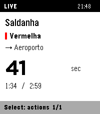
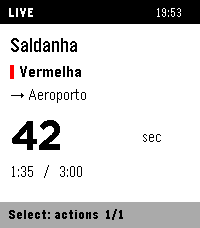
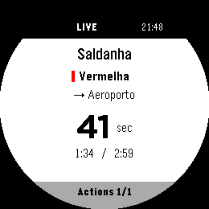
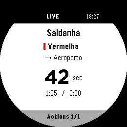
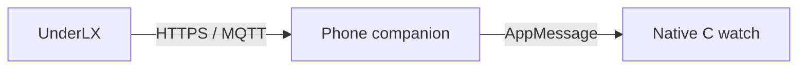
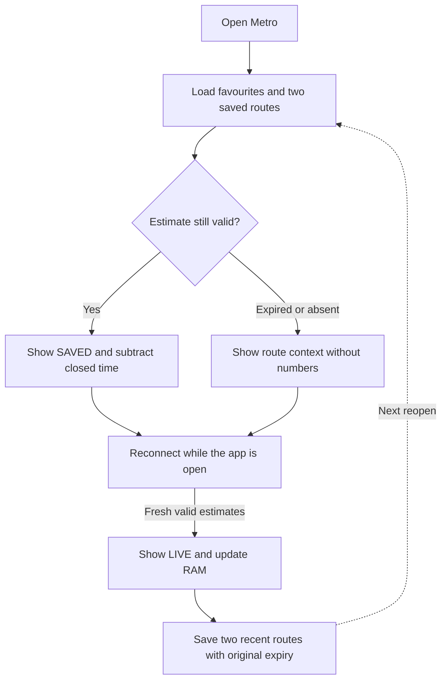

# Arrivals-first flow

The native app uses one window and drawing layer, fixed-size models and direct
button navigation plus optional SDK tap/swipe input on Time 2 and Round 2.
No alerts, vibration, on-watch settings or service-status dashboard.
The optional [phone favourites editor](phone-configuration.md) complements this
watch flow; both use the watch's validated, transactionally saved list.

## Navigation

```text
Launch with favourites → last viewed arrivals
  Up/Down → previous/next favourite
  Select → Retry live data / Remove favourite
  Back → favourites list

First use → Select → line → station on that line → direction → save
Favourites list → Add favourite → the same line-first flow
Favourites list → Retry data
Back at favourites root or empty screen → exit
```

Each favourite is a station + line + reachable terminus. The line picker uses the
catalogue names; stations are filtered by that line and stay alphabetical.
Interchanges keep the chosen line; termini exclude the origin as a destination.
Back restores the previous picker row, and cancelling saves no draft. A changed
catalogue clears an open draft/history and asks the user to choose again.
Up to 16 favourites persist.
Holding Up/Down repeats. Removal is confirmed and preserves other routes' slots,
arrival state and original expiry. Favourite mutations commit the entire list through
the same recoverable bank store, whether initiated on the watch or phone.

Touch uses the same actions and four-row pages: tap a visible row to activate that
row, swipe up/down for next/previous, and swipe right for Back. Main-content taps
open Actions on arrivals, add/retry on first use, and return from notices.
Removing a favourite requires a fresh contact on the explicit confirmation row;
there is no swipe-to-delete. Blank rows, headers/footers and round-screen corners
are excluded. A contact is discarded if buttons/navigation, focus loss or catalogue
replacement changes its target. A tap ending on a different row is ignored.

## Arrivals

- Status strip and watch-local clock on the selected line colour, including saved
  routes. Missing colour falls back to black; SDK contrast selection keeps text
  legible on all four colours, including yellow.
- Station and destination, with no separate line-name row on arrivals. The line
  picker retains textual names so selecting a route does not depend on colour.
- Next estimate prominently displayed, with two following estimates underneath.
- Source seconds, approximate minutes (`~`), ranges and bounds retain their meaning.
- `Due` / `Estimated now` does not assert observed train presence.
- Footer identifies actions and favourite position.

Switching changes an index/subscription, without allocating a menu/object tree.
Only visible menu rows are drawn. Static menus redraw on changes or the minute
clock tick, not every second.

Time 2 uses the rectangular layout. Round 2 centers the station/direction,
measures the main ETA and its unit as one centered group, and insets header/footer
text away from the circular edge. The last of four menu rows is narrower to stay
inside the bottom curve. Compact round footers keep counts such as 17/18 visible.
These are layout differences only; estimates, cache and navigation semantics match.

The reclaimed line row gives numeric ETAs the SDK's LECO 60 Bold font on both
watches. Approximation and bound prefixes retain their Gothic glyphs beside the
larger number; ranges, Due and missing data use Gothic. The whole value, prefix
and unit are measured before drawing, falling back to Roboto 49, Bitham 42 and
Gothic 24 for wide values. No custom font, locale change or invented precision is
introduced. Header/footer bounds, touch targets and train position are unchanged.
See the official [system fonts](https://developer.repebble.com/guides/app-resources/system-fonts/)
and [font subset limitations](https://developer.repebble.com/guides/app-resources/fonts/).

Before/after numeric layout (actual emulator fixtures, not live train observations):

| Target | Before | After |
| --- | --- | --- |
| Time 2 |  |  |
| Round 2 |  |  |

Fixture data contains information from [UnderLX](https://underlx.com/), made
available under [ODbL 1.0](https://opendatacommons.org/licenses/odbl/1-0/).
See [data methods](../DATA_METHODS.md).

## Data path



Only the selected station is subscribed. The watch app does not use a custom
server, GPS or a background worker.

## Reopen cache



All favourites persist; only two recent routes have durable arrival snapshots.
Other snapshots are RAM-only until revisited. Cache writes batch to 15 seconds
and flush on switching, normal exit or focus loss; countdown ticks do not write
storage. Saving never extends source expiry.

Expired or invalidated numbers disappear. Short route labels can remain. Empty
updates invalidate the affected route; feed gaps, Retry and clock discontinuities
invalidate estimates globally. See [architecture](architecture.md) for failure
handling and the chunk/receipt protocol.

A tiny train animates beside **Updating** using four frames on the one-second tick.
It pauses while unfocused and stops after at most 15 seconds per attempt/target or
on explicit failure. Navigation remains available while waiting.

## Upgrades and acceptance

Version 0.2 keeps the app UUID but uses native integer-keyed persistence rather
than Alloy WebStorage. Old favourites must be re-added; the old store is untouched.
Uninstalling or erasing data is not a migration shortcut.

Emulator navigation/cache tests and heap headroom are required but do not replace
physical repeated-switch, reconnect, reopen and battery testing. See
[E2E](e2e.md) and the [publishing guide](appstore.md).
