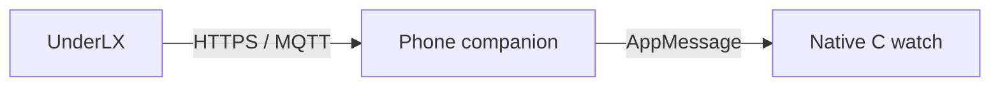
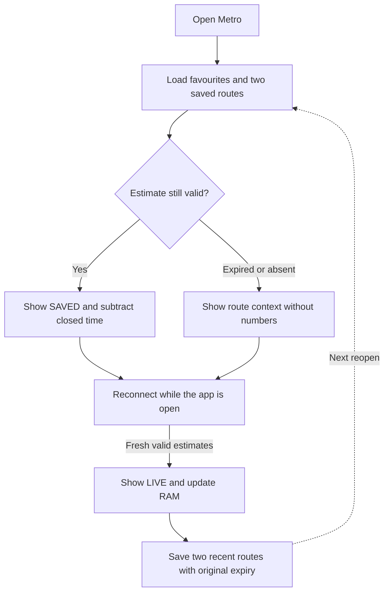

# Arrivals-first flow

The native app uses one window and drawing layer, fixed-size models and direct
button navigation on Time 2 and Round 2. No alerts, vibration, settings or
service-status dashboard.

## Navigation

```text
Launch with favourites → last viewed arrivals
  Up/Down → previous/next favourite
  Select → Retry live data / Remove favourite
  Back → favourites list

First use → Select → station → line if needed → direction → save
Favourites list → Add favourite / Retry data / About
Back at favourites root or empty screen → exit
```

Each favourite is a station + line + reachable terminus. Interchanges offer a line
picker; termini exclude the origin as a destination. Up to 16 favourites persist.
Holding Up/Down repeats. Removal is confirmed and does not rewrite other favourites.

## Arrivals

- Status strip and watch-local clock.
- Station, line colour/name and destination; colour is never the only label.
- Next estimate prominently displayed, with two following estimates underneath.
- Source seconds, approximate minutes (`~`), ranges and bounds retain their meaning.
- `Due` / `Estimated now` does not assert observed train presence.
- Footer identifies actions and favourite position.

Switching changes an index/subscription, without allocating a menu/object tree.
Only visible menu rows are drawn. Static menus redraw on changes or the minute
clock tick, not every second.

Time 2 uses the rectangular layout. Round 2 centers the station/line/direction,
measures the main ETA and its unit as one centered group, and insets header/footer
text away from the circular edge. The last of four menu rows is narrower to stay
inside the bottom curve. Compact round footers keep counts such as 17/19 visible.
These are layout differences only; estimates, cache and navigation semantics match.

## Data path



Only the selected station is subscribed. The watch app does not use a custom
server, GPS or a background worker.

## Reopen cache



All favourites persist; only two recent routes have durable arrival snapshots.
Other snapshots are RAM-only until revisited. Cache writes batch to 15 seconds
and flush on switching, normal exit or focus loss; countdown ticks do not write
storage. Saving never extends source expiry.

Expired or invalidated numbers disappear. Short route labels can remain. Empty
updates invalidate the affected route; feed gaps, Retry and clock discontinuities
invalidate estimates globally. See [architecture](architecture.md) for failure
handling and the chunk/receipt protocol.

A tiny train animates beside **Updating** using four frames on the one-second tick.
It pauses while unfocused and stops after at most 15 seconds per attempt/target or
on explicit failure. Navigation remains available while waiting.

## Upgrades and acceptance

Version 0.2 keeps the app UUID but uses native integer-keyed persistence rather
than Alloy WebStorage. Old favourites must be re-added; the old store is untouched.
Uninstalling or erasing data is not a migration shortcut.

Emulator navigation/cache tests and heap headroom are required but do not replace
physical repeated-switch, reconnect, reopen and battery testing. See
[E2E](e2e.md) and the [release checklist](publishing-todo.md).
